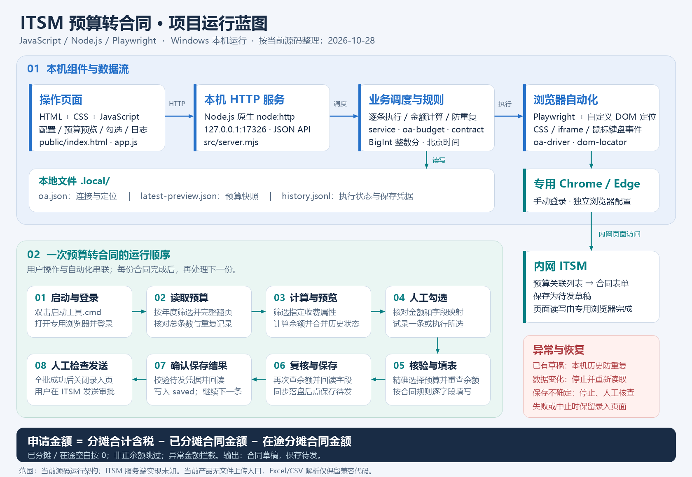
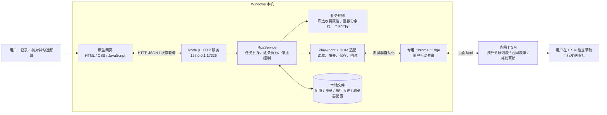

# 项目技术说明与运行蓝图

核对日期：2026-11-02。依据当前工作区源码整理；运行蓝图绘制于 2026-10-28。

这是一个运行在 Windows 本机的 ITSM 预算转合同 RPA 工具。核心代码使用 **JavaScript**，以 **Node.js + Playwright + 原生网页** 实现：用户在本机页面操作，程序控制专用 Chrome / Edge 浏览器，读取 ITSM 预算并生成合同草稿，完成后保存待发，用户自行检查并发送审批。

## 技术与语言

| 部分 | 技术 / 语言 | 在项目中的作用 | 代码位置 |
| --- | --- | --- | --- |
| 核心程序 | JavaScript，ES Modules（`.mjs` / `.js`） | 服务、业务规则、浏览器自动操作，以及页面交互 | `src/`、`public/app.js` |
| 运行环境 | Node.js ≥ 22 | 运行本机服务和 RPA 任务；没有独立编译构建步骤 | `package.json` |
| 操作页面 | HTML5、CSS、原生 JavaScript | 连接配置、年度选择、预算预览、勾选执行和运行日志 | `public/index.html`、`public/style.css`、`public/app.js` |
| 本机接口 | Node.js 原生 `node:http`，HTTP + JSON，浏览器 `fetch` | 提供静态页面及 API，监听 `127.0.0.1:17326`；页面每 2 秒刷新状态 | `src/server.mjs`、`public/app.js` |
| 自动化 | Playwright；依赖声明 `^1.56.0` | 启动有界面的 Chrome / Edge，读取页面、翻页、输入、点击和回读 | `src/oa-driver.mjs` |
| 页面定位 | CSS selector、iframe 链、DOM 查询、鼠标键盘事件 | 精确定位 ITSM 表单；自定义适配层兼容旧页面覆盖 `window.Set` 的情况 | `src/dom-locator.mjs` |
| 金额规则 | JavaScript `BigInt`，整数分 | 校验金额格式，精确计算余额，避免金额浮点运算误差 | `src/oa-budget.mjs`、`src/budget.mjs` |
| 本地保存 | JSON、JSONL、文件系统；SHA-256 摘要 | 保存配置、预览和逐条执行历史；根据年度与预算编号识别同一预算 | `src/history.mjs`、`src/service.mjs` |
| 兼容解析 | ExcelJS 4.4.0；自定义 CSV 解析 | 旧 Excel/CSV 流程与兼容性测试仍使用；当前页面及 API 没有上传入口 | `src/budget.mjs` |
| 启动与测试 | Windows Batch；Node.js 内置 `node:test` | 双击启动工具；使用 `npm.cmd test` 验证规则、服务及浏览器适配逻辑 | `启动工具.cmd`、`tests/` |

当前依赖中没有 React、Vue、Express、数据库或大模型 SDK。ITSM 是被操作的外部系统，其服务端语言不能由本项目源码判断。程序通过浏览器页面交互接入 ITSM，没有直接调用 ITSM 业务接口；等待页面查询响应是为了判断操作完成。

## 运行蓝图

可编辑矢量版：`project-runtime-blueprint.svg`。

## 一次任务怎样运行

1. 双击 `启动工具.cmd`，启动 `src/server.mjs` 并打开本机页面。首次缺少依赖时，启动脚本运行 `npm ci` 安装。
2. 用户点击“打开 ITSM 登录”，Playwright 启动专用的有界面浏览器，用户手动登录。
3. 点击“读取 ITSM 预算”，通过 `POST /api/oa/scan` 打开合同及项目编号关联列表，按年度筛选、读取全部分页并核对总条数。
4. `oa-budget.mjs` 仅保留“控股企业信息分摊费”，计算：**本次申请金额 = 分摊合计含税 − 已分摊合同金额 − 在途分摊合同金额**。已分摊和在途空白按配置视为 0；非正余额跳过，金额异常禁止执行。
5. 页面展示三项金额、余额和历史状态。用户核对后选择试录一条或执行所选，调用 `POST /api/run`。后台逐条处理，不并行填写多份合同。
6. 每条预算先检查本机历史，再在 ITSM 中精确选择年度与预算编号并重新核对余额，按规则填写合同。名称、说明和签订日期使用实际执行当天的北京时间；合同年份与预算年度独立。
7. 保存前再次查询余额、回读表单，并将 `saving` 状态同步写入执行历史，然后只点击一次“保存待发”。按已接入的 `seeyon-wait-send` 模式，核对返回的 `summaryId`、`affairId` 和 `from=waitSend`，重新回读字段后才记为 `saved`。
8. 全批次均确认成功后关闭合同录入页，保留 ITSM 主页。用户自行检查草稿并发送审批。点击停止时，当前合同结束后停止后续处理。

## 本地数据与异常处理

| 文件 / 目录 | 内容与用途 |
| --- | --- |
| `.local/oa.json` | 实际 ITSM 地址、浏览器选项、页面定位和接入验证配置；缺失时读取空白示例 |
| `.local/latest-preview.json` | 最近一次预算预览；恢复预览后仍须重新核对实时数据 |
| `.local/history.jsonl` | 追加式执行历史；保存前同步落盘，用于恢复和本机防重复 |
| `.local/browser-profile/` | 专用浏览器配置与会话数据；会话可能失效，届时重新登录 |

运行日志在服务内存中维护并显示在页面；持久化执行结果以 `history.jsonl` 为准。已保存预算再次出现时跳过；保存过程被中断或结果不确定时，标记待核查并停止批次，禁止自动重建。正常保存前失败的预算保留错误信息，可在排除问题后重试。金额或关键数据与预览不一致时，停止并要求重新读取。

本地防重复依赖该工具的历史文件，迁移应保留配置与历史。实时余额复核和 ITSM 保存是分开的页面操作，不构成跨用户数据库事务。

## 运行条件与核对范围

需要 Windows、Node.js ≥ 22、配置指定的 Chrome 或 Edge、可访问 ITSM 内网，以及已核实的页面定位配置。当前服务仅绑定本机回环地址；API 使用每次启动生成的本地令牌，并检查 Host 和 Origin。

本说明基于源码和本地测试整理，不代表本次重新执行了真实 ITSM 合同业务；README 中的历史业务验收记录与本次源码核对分开理解。

2026-11-02 上传代码前运行全部 85 项本地测试，85 项通过，无失败、跳过或取消。测试使用本地模拟表单和虚构数据，没有执行真实 ITSM 合同业务。蓝图 PNG 已目视检查，SVG 已通过 XML 解析检查。
